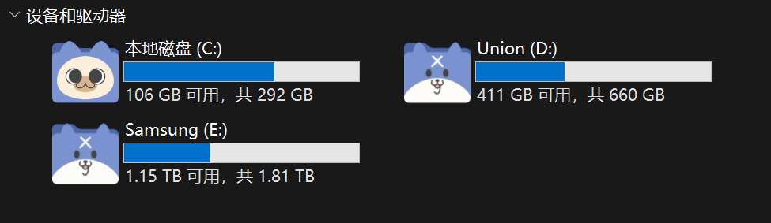

本文整理了两种更换硬盘图标的方法：

1. **方法一（推荐）：批量修改注册表** —— 免放文件在盘符根目录，稳定且适用于 Windows 10 / 11 内部固态与机械硬盘。
2. **方法二：autorun.inf 配置文件法** —— 适合移动硬盘、U盘等便携设备。

文中附上博主自用的图标以及图片转 `.ico` 的在线工具供大家自取下载。

***

## 效果展示



***

## 准备工作：自取博主自用图标与格式转换

更换图标的前提是拥有 `.ico` 格式的图标文件（普通 `.png` 或 `.jpg` 无法直接用作盘符图标）。

### 1. 博主自用图标直接下载

博主目前使用的两款图标已存放在本站，点击即可直接自取下载：

| 图标 | 下载链接 |
| :---: | :---: |
|  | [点击下载 daimao1.ico](daimao1.ico) |
|  | [点击下载 daimao2.ico](daimao2.ico) |

> 💡 **提示**：下载后，建议将图标放置在一个长期不会被误删的固定路径中，例如 `D:\alask\OneDrive\Pictures\ico\`。可以在下方的 PowerShell 脚本中将路径替换为你实际存放的位置。

### 2. 将自己的图片转为 .ico 图标

如果你想使用自己喜欢的动漫、游戏或设计图片，可以使用下面的在线转换工具：

* **转换网站**：[ico5 在线图片转 ICO 工具 (https://ico5.net/)](https://ico5.net/)
* **建议设置**：选择生成包含 `16x16`, `32x32`, `48x48`, `64x64`, `128x128`, `256x256` 完整尺寸的 Multi-Size ICO 文件，这样在“超大图标”、“大图标”和“详细信息”等不同查看视图下都能高清显示，不会模糊。

***

## 方法一：通过注册表修改（推荐）

Windows 原生支持在注册表中为每个盘符定义 `DriveIcons`。

博主编写了一段 PowerShell 脚本，支持为 C 盘设置专属图标，并一键循环为 D 到 Z 盘所有可能存在的盘符批量设置第二个图标。

### 1. PowerShell 自动化命令

以**管理员身份**打开 PowerShell，执行以下脚本即可：

```powershell
# 1. 设置你的图标本地存储路径（按需修改为你存放图标的位置）
$ico1 = "D:\alask\OneDrive\Pictures\ico\daimao1.ico"
$ico2 = "D:\alask\OneDrive\Pictures\ico\daimao2.ico"

# 2. 注册表基路径
$base = "HKLM\SOFTWARE\Microsoft\Windows\CurrentVersion\Explorer\DriveIcons"

# 3. 设置 C 盘图标
reg add "$base\C\DefaultIcon" /ve /d $ico1 /f

# 4. 循环为 D 到 Z 盘批量设置图标
$letters = [char[]](( [int][char]'D' )..( [int][char]'Z' ))
foreach ($L in $letters) {
    reg add "$base\$L\DefaultIcon" /ve /d $ico2 /f
}
```

### 2. 参数与定制说明

只需对上述命令做两点简要修改，即可满足自己的需求：

1. **修改路径**：将第一行和第二行的 `$ico1` 与 `$ico2` 双引号内的路径，替换为你自己电脑上存放图标的真实绝对路径。
2. **单独定制某盘**：如果你想给特定盘设置不同的图标，只需单独写一行：

```powershell
reg add "$base\D\DefaultIcon" /ve /d "D:\Icons\game.ico" /f
```

### 3. 即时生效与刷新缓存

执行完命令后，如果“此电脑”中的图标没有立刻变化，这是因为 Windows 资源管理器有图标缓存。

在 PowerShell 中运行以下命令重启资源管理器，即可立即看到新图标：

```powershell
Stop-Process -Name explorer -Force
```

### 4. 如何恢复？

如果以后想恢复系统默认外观，只需在管理员 PowerShell 中删除 `DriveIcons` 注册表项即可：

```powershell
reg delete "HKLM\SOFTWARE\Microsoft\Windows\CurrentVersion\Explorer\DriveIcons" /f
Stop-Process -Name explorer -Force
```

***

## 方法二：使用 autorun.inf

`autorun.inf` 是 Windows 经典的自动运行配置文件，非常适合**移动硬盘**、**U 盘**等设备（插入任何电脑都能显示自定义图标）。

### 1. 操作步骤

1. 打开你要更换图标的盘符根目录（例如 `D:\` 根目录）。
2. 将准备好的图标复制到该盘根目录下，命名为例如 `icon.ico`。
3. 在根目录下新建一个文本文件，重命名为 `autorun.inf`（注意后缀必须是 `.inf`，而不是 `.txt`）。
4. 用记事本打开 `autorun.inf`，写入以下内容并保存：

```ini
[AutoRun]
Icon=icon.ico,0
Label=我的数据盘
```

> **参数说明**：
> * `Icon=icon.ico,0`：表示使用根目录下的 `icon.ico` 作为图标文件。
> * `Label=我的数据盘`：可选，用于自定义驱动器卷标名称。

5. （可选）为了防止误删，可以在该盘根目录下以管理员运行命令提示符，将这两个文件设为隐藏与系统文件：

```cmd
attrib +h +s autorun.inf
attrib +h +s icon.ico
```

6. 拔出移动硬盘重新插入，或者重启资源管理器，即可生效。

***
